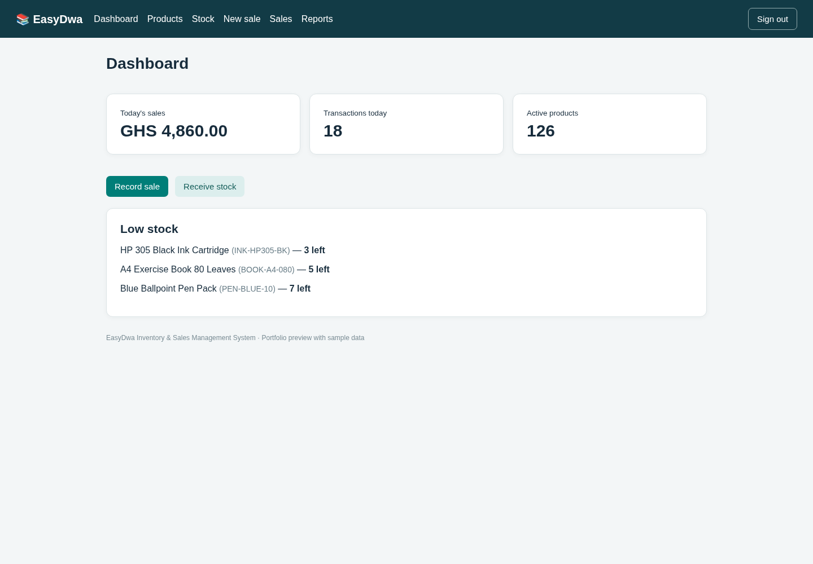
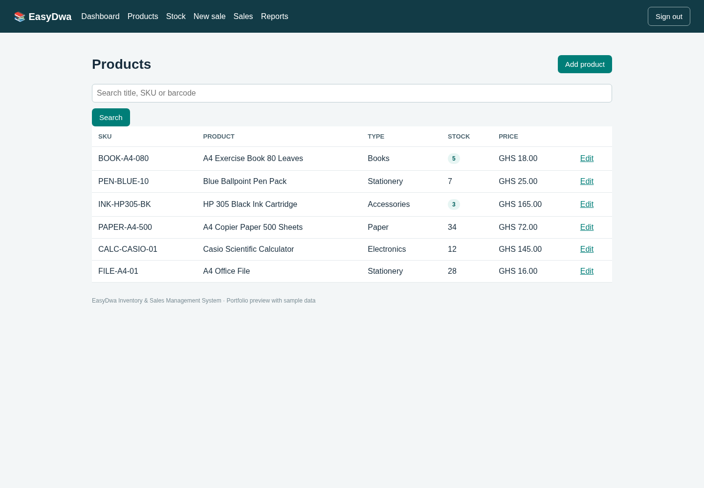
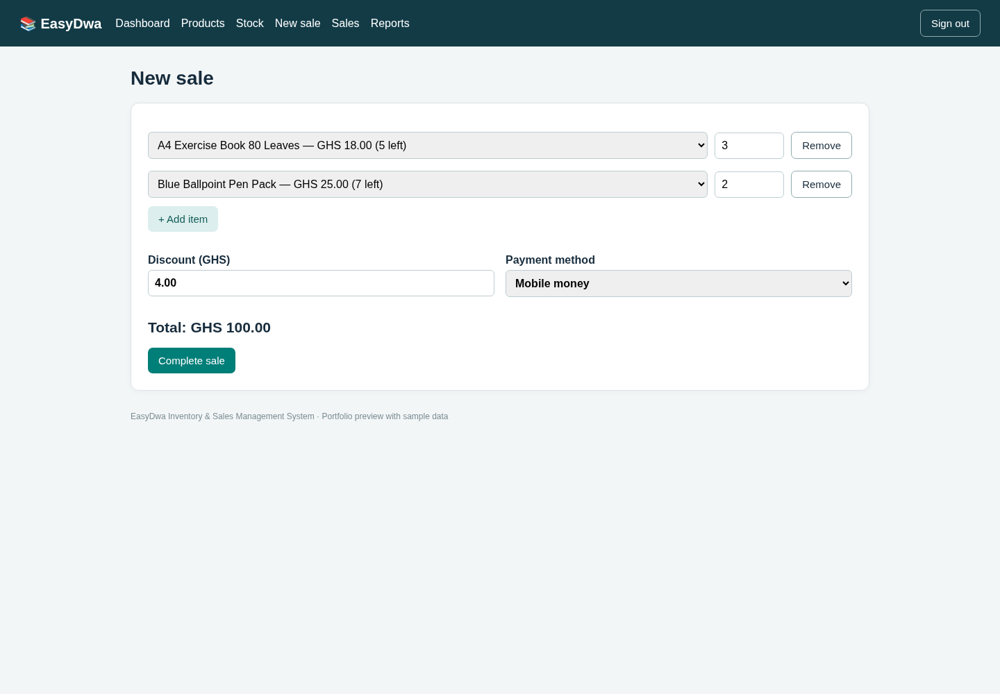
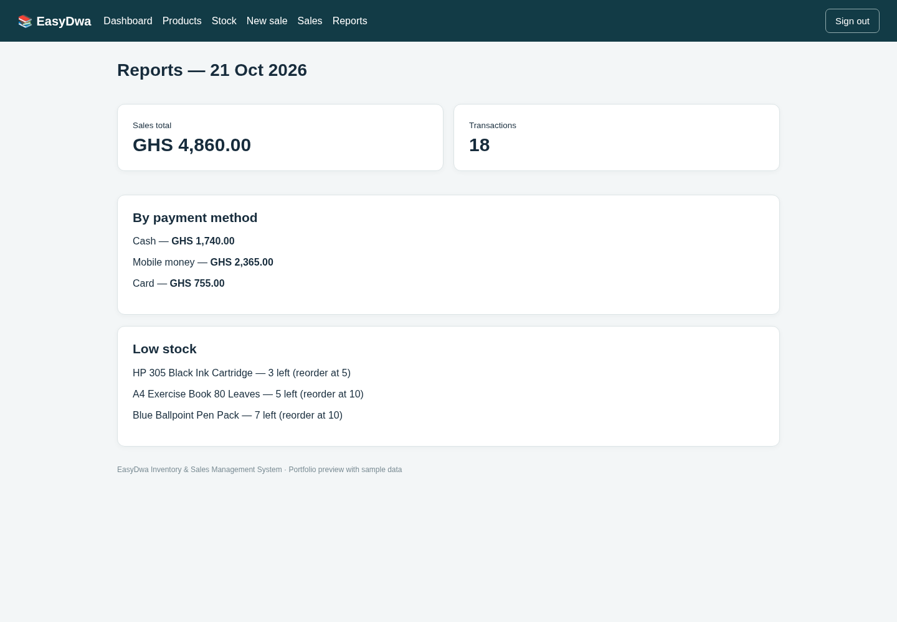

# EasyDwa Inventory & Sales Management System

EasyDwa is a lightweight inventory and sales management application built for a small book and stationery shop. It is designed to run locally on a Windows computer and helps a business manage products, stock movements, sales, receipts, returns, and basic daily reporting.

## Key Features

- Secure user login using Django authentication
- Product management with SKU and optional barcode/ISBN
- Stock receiving and stock adjustments
- Low-stock monitoring using reorder levels
- Sales recording with Cash, Mobile Money, Card, and Other payment methods
- Automatic stock deduction after a sale
- Printable sales receipts
- Item-return processing that restores stock
- Daily sales dashboard and payment-method reporting
- Local SQLite database
- Windows setup, startup, and backup scripts

- ## Screenshots

### Dashboard


### Product Management


### Sales Processing


### Daily Reports


> Screenshots use sample data to demonstrate the interface and workflows without exposing real business or customer information.

## Technology Stack

- Python
- Django 5
- HTML
- CSS
- JavaScript
- SQLite
- Windows batch scripts

## Project Structure

```text
EasyDwa/
├── bookshop/
│   ├── static/
│   └── templates/
├── config/
├── store/
│   └── migrations/
├── manage.py
├── requirements.txt
├── setup_windows.bat
├── start_windows.bat
└── backup_windows.bat
```

## Local Setup

1. Install Python 3.12 or newer.
2. Clone or download this repository.
3. On Windows, run:

```text
setup_windows.bat
```

4. Create an administrator username and password when prompted.
5. Start the application with:

```text
start_windows.bat
```

6. Open `http://127.0.0.1:8000/` in a browser and sign in.

For manual development setup:

```bash
python -m venv .venv
pip install -r requirements.txt
python manage.py migrate
python manage.py createsuperuser
python manage.py runserver 127.0.0.1:8000
```

## Main Workflows

### Products
Create and update products with a name, SKU, category, supplier, cost price, selling price, starting stock, and reorder level.

### Stock
Record stock received and inventory corrections. Stock movements are logged for traceability.

### Sales
Create a sale by selecting products and quantities. Product prices are read from stored product records, and stock is reduced automatically after a successful sale.

### Returns
Returned items can be recorded from the original receipt and are added back into stock.

### Reports
The system displays daily sales totals, transaction counts, sales grouped by payment method, and low-stock products.

## Data & Security Notes

- The application is configured for local use on `127.0.0.1`.
- The SQLite database (`shop.sqlite3`) should not be committed to a public repository.
- Environment variables should be used for sensitive production secrets.
- `DEBUG=True` and the bundled development server are intended for local development only.
- Backups may contain real business data and should remain private.

## Current Scope

This version does not yet include barcode-scanner integration, tax computation, cash-drawer integration, customer accounts, refund accounting, or automated scheduled backups.

## Project Purpose

This project was developed to apply Information Technology Management skills to a practical business problem: improving inventory visibility, sales recording, stock control, and day-to-day record keeping for a small retail business.

## Author

Nancy Samuella Asantewaa Asante
